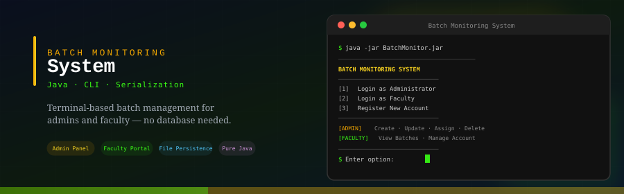

<div align="center">
  
</div>

<br/>

<div align="center">

[](https://docs.oracle.com/en/java)
[]()
[]()
[](LICENSE)

**A terminal-based batch management system built in pure Java.**  
Admin and faculty roles · CRUD operations on batches · File-based persistence · No external dependencies.

</div>

---

## About

Batch Monitoring System is a Java CLI application that manages the relationship between **admins** and **faculty members** across academic or training batches.

Admins have full control — they can create, update, assign, and delete batches. Faculty members can self-register, log in, and view their assigned batches. All data is persisted between sessions using Java serialization, with no database or third-party library required.

The project also ships two hand-rolled utility classes: a `Design & Print` class for styled terminal output, and a `Database` class that abstracts serialization and deserialization behind a clean interface.

---

## Features

### Admin
- Create a new batch
- Update an existing batch
- Assign a faculty member to a batch
- View all batches
- View a specific batch
- View batches assigned to a particular faculty
- Delete a batch
- Logout

### Faculty
- Register a new account
- Login
- View all assigned batches
- Delete own account
- Logout

### Custom Libraries (hand-built)
- **Design & Print** — utility class for applying custom styling and formatted output to the terminal
- **Database** — wrapper class managing Java serialization and deserialization for persistent file-based storage

---

## Technologies

- **Java** (pure, no external dependencies)
- Java Serialization API for file persistence
- Terminal / CLI interface

---

## Installation

1. Clone the repository:
   ```shell
   git clone https://github.com/viveKing21/bashful-invention-7775.git
   ```

2. Import the project into your preferred Java IDE (e.g., IntelliJ IDEA, Eclipse).

3. Build the project using your IDE or via the command line:
   ```shell
   javac -d out src/**/*.java
   ```

---

## Usage

Run the application using the provided batch file:

```shell
run.bat
```

Or directly via Java:

```shell
java -jar BatchMonitor.jar
```

### Startup Menu

```
[1]  Login as Administrator
[2]  Login as Faculty Member
[3]  Create a New Account
```

### Admin Options

| Option | Action |
|--------|--------|
| 1 | Create a new batch |
| 2 | Update an existing batch |
| 3 | Assign faculty to a batch |
| 4 | View all batches |
| 5 | View a specific batch |
| 6 | View batches assigned to a faculty |
| 7 | Delete a batch |
| 8 | Logout |

### Faculty Options

| Option | Action |
|--------|--------|
| 1 | View assigned batches |
| 2 | Delete account |
| 3 | Logout |

> **Admin credentials** are static and configured at compile time. Faculty members self-register through the CLI.

---

## Screenshots


---

## Project Structure

```
bashful-invention-7775/
├── src/
│   ├── Main.java              # Entry point
│   ├── Admin.java             # Admin role logic
│   ├── Faculty.java           # Faculty role logic
│   ├── Batch.java             # Batch model
│   ├── Database.java          # Serialization / deserialization utility
│   └── DesignPrint.java       # Terminal styling utility
├── Screenshots/
├── run.bat                    # Windows run script
└── README.md
```

---

## Contributing

Contributions are welcome. If you have suggestions, bug reports, or improvements, please open an issue or submit a pull request.

---

## References

- [Java Documentation](https://docs.oracle.com/en/java)
- [Java Serialization Guide](https://docs.oracle.com/javase/8/docs/technotes/guides/serialization/)
